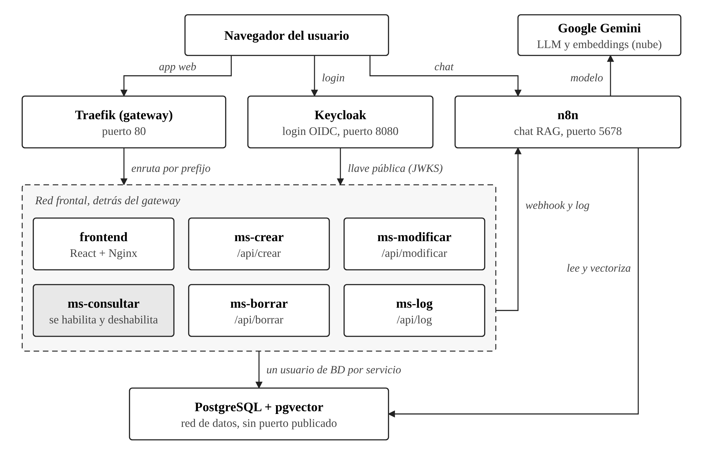

# Gestión de Datos Personales

Proyecto final de Diseño de Software II (Universidad del Norte, periodo 202630).
Equipo: Carlos Ruidiaz, Claudia Elias, Juan Fernandez y Daniel Mendez. Profesor: Pierre Julliard Amador.

Aplicación para crear, modificar, consultar y borrar datos personales usando el número de documento como llave. Responde preguntas en lenguaje natural sobre esos datos con un agente RAG en n8n y registra toda transacción en un log de auditoría consultable. Cada opción del menú es un microservicio y todo corre en contenedores con Docker Compose.

> **Estado del proyecto, tablero de tareas y forma de trabajo:** están en [CONTEXTO.md](CONTEXTO.md). Léelo antes de tocar algo. Si usas una IA, pídele «Lee CONTEXTO.md y dime en qué estado está el proyecto y qué me toca hacer».

## Arquitectura

| Pieza | Tecnología |
| --- | --- |
| Frontend | React con Vite y TypeScript, servido con Nginx |
| Microservicios (crear, modificar, consultar, borrar, log) | NestJS con TypeScript |
| API Gateway | Traefik |
| Base de datos | PostgreSQL 16 con pgvector |
| Autenticación | Keycloak (OpenID Connect) |
| Consulta en lenguaje natural | n8n con un agente de IA y Google Gemini |



El detalle está en el [documento de diseño](docs/diseno/documento_diseno.md).

## Requisitos

- Docker Desktop (en Windows, con WSL2 y virtualización activada), con al menos 8 GB de RAM en el equipo.
- Git.
- Puertos libres: 80 (aplicación), 8080 (Keycloak) y 5678 (n8n).
- Conexión a internet y una llave de API gratuita de Google Gemini, para la consulta en lenguaje natural.

## Cómo arrancarlo

```bash
git clone <url-del-repositorio>
cd gestion-datos-personales
cp .env.example .env        # completar llaves y contraseñas
docker compose --profile consultar up -d --build
```

La aplicación queda en <http://localhost>. Qué servicios arrancan hoy y cómo comprobar que funcionan está en la sección 3 de [CONTEXTO.md](CONTEXTO.md), que se mantiene al día con cada tarea.

La opción Consultar se habilita y deshabilita según demanda:

```bash
docker compose stop ms-consultar                            # deshabilitar
docker compose up -d ms-consultar                           # habilitar
docker compose up -d --scale ms-consultar=3 ms-consultar    # tres réplicas
```

## Estructura del repositorio

```
frontend/         interfaz web
services/         ms-crear, ms-modificar, ms-consultar, ms-borrar, ms-log
libs/common/      entidad, DTO, guard JWT y módulo de auditoría compartidos
n8n/workflows/    flujos de n8n exportados en JSON
keycloak/         realm.json con clientes, roles y usuarios de prueba
database/         init.sql con tablas, índices, usuarios y permisos
docs/             enunciado, documento de diseño y notas del equipo
docker-compose.yml
```

## Documentación

- [CONTEXTO.md](CONTEXTO.md): estado actual, tablero de tareas, decisiones y protocolo de trabajo.
- [docs/enunciado.md](docs/enunciado.md): enunciado y rúbrica del profesor.
- [docs/diseno/documento_diseno.md](docs/diseno/documento_diseno.md): documento de diseño entregado.
- [docs/notas_del_equipo.md](docs/notas_del_equipo.md): decisiones del equipo que complementan el diseño.

## Datos y secretos

Solo se usan datos ficticios. Las llaves y contraseñas viven en `.env`, que no se sube al repositorio.
