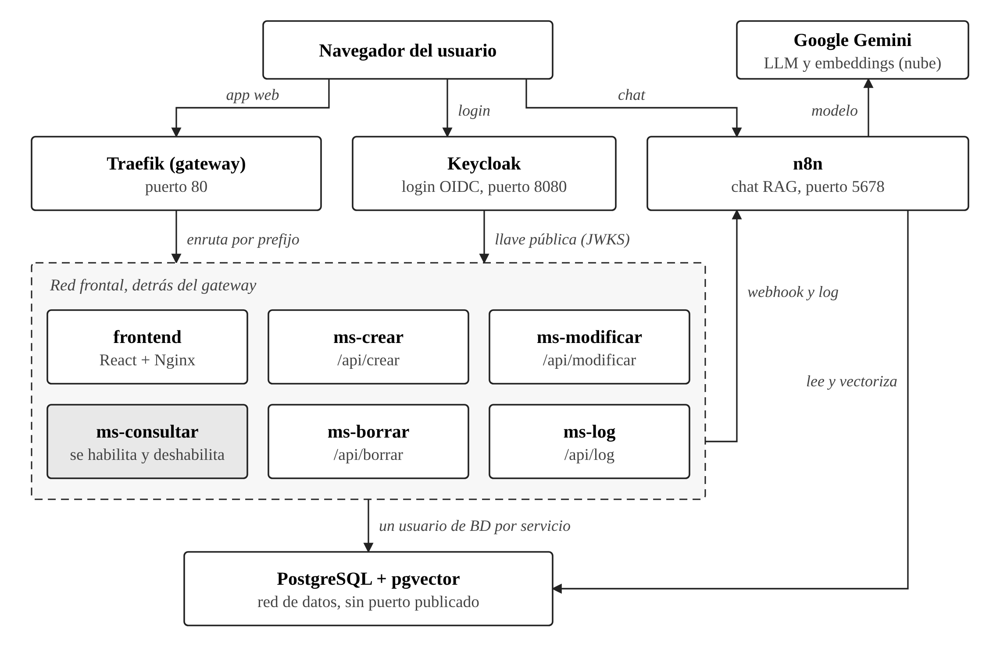
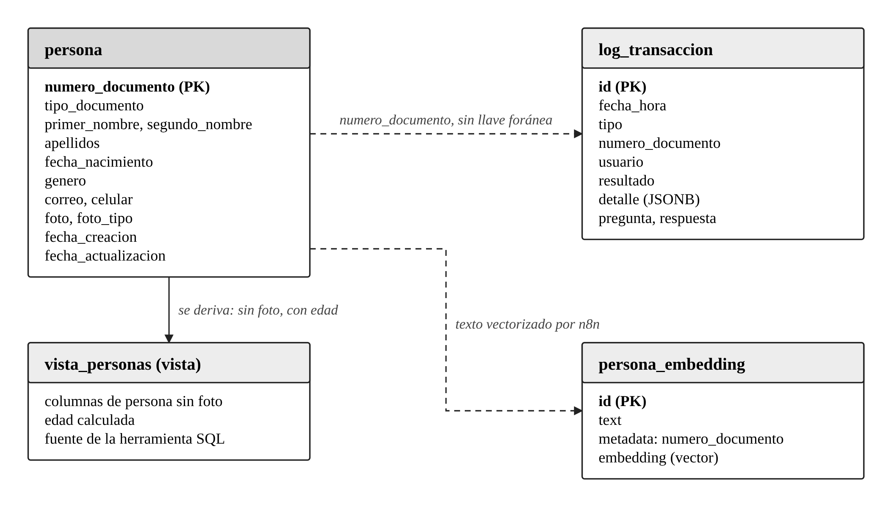
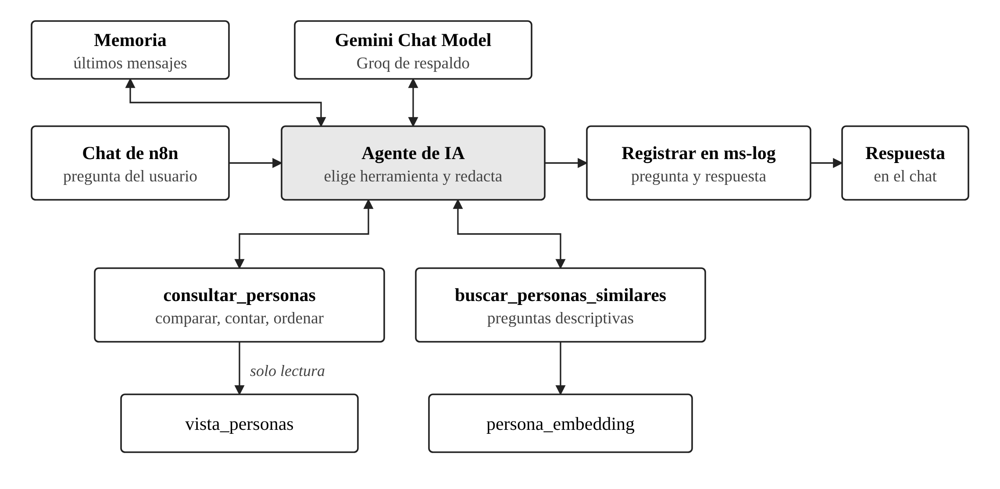

# Documento de Diseño de Software: Gestión de Datos Personales

Diseño de Software II, Universidad del Norte, periodo 202630.
Presentado por Carlos Ruidiaz, Claudia Elias, Juan Fernandez y Daniel Mendez. Profesor: Pierre Julliard Amador.

Versión en Markdown del documento entregado (Documento de diseño.pdf). El contenido es el mismo.

## 1. Introducción

### 1.1 Propósito

Este documento describe el diseño de la aplicación Gestión de Datos Personales, proyecto final del curso Diseño de Software II. Presenta los requerimientos, la arquitectura, el modelo de datos, las interfaces, la seguridad y el despliegue del sistema, y sirve como guía común para el equipo durante la implementación.

### 1.2 Alcance

El sistema permite crear, modificar, consultar y borrar los datos personales de un grupo de personas, usando el número de documento como llave de búsqueda. También responde preguntas en lenguaje natural sobre esos datos mediante el patrón RAG implementado en n8n, y registra cada transacción en un log de auditoría que se puede consultar con filtros. Todo el sistema se ejecuta en contenedores sobre un equipo local con Docker Desktop.

Quedan fuera del alcance el despliegue en la nube, la gestión de usuarios desde la propia aplicación (se administran en el proveedor de identidad) y la carga masiva de datos desde sistemas externos.

### 1.3 Definiciones

| Término | Definición                                                                                                                                    |
|-------------|---------------------------------------------------------------------------------------------------------------------------------------------------|
| API Gateway | Punto de entrada único que recibe las peticiones del cliente y las enruta al microservicio correspondiente                                        |
| Embedding   | Representación numérica (vector) de un texto que permite comparar significados por similitud                                                      |
| JWT         | Token firmado que transporta la identidad y los roles del usuario autenticado                                                                     |
| LLM         | Modelo de lenguaje de gran tamaño, capaz de interpretar y generar texto                                                                           |
| OIDC        | OpenID Connect, protocolo de autenticación construido sobre OAuth 2.0                                                                             |
| RAG         | Generación aumentada por recuperación. Se recupera información de una fuente de datos y se entrega al LLM como contexto para generar la respuesta |
| SSO         | Inicio de sesión único mediante un proveedor central de identidad                                                                                 |

## 2. Descripción general

### 2.1 Contexto y objetivo

Las organizaciones necesitan mantener datos personales actualizados, consultarlos con rapidez y demostrar quién hizo qué sobre ellos. Esta aplicación centraliza esa gestión en un sistema seguro y trazable, y permite hacer preguntas en lenguaje natural sobre los datos registrados, como «¿cuál es el empleado más joven que se ha registrado?», sin escribir consultas técnicas.

El menú principal ofrece seis opciones: crear personas, modificar datos personales, consultar datos personales, consultar datos personales en lenguaje natural (desde la interfaz de n8n), borrar personas y consultar el log.

### 2.2 Usuarios

El sistema tiene dos roles, administrados en Keycloak. El **Administrador** puede usar todas las opciones del menú. El **Consultor** solo puede consultar datos personales, usar la consulta en lenguaje natural y consultar el log.

### 2.3 Supuestos y restricciones

Del enunciado se derivan las restricciones principales: cada opción del menú es un microservicio, toda la aplicación se despliega en contenedores, la base de datos y la opción Consultar viven en contenedores independientes (Consultar debe poder habilitarse y deshabilitarse según demanda), la autenticación usa un SSO reconocido y la consulta en lenguaje natural se implementa en n8n aplicando RAG.

El equipo asume además que solo se usan datos ficticios, que el sistema se ejecuta en un equipo con Docker Desktop, al menos 8 GB de RAM y conexión a internet, y que solo se usan servicios externos con nivel gratuito.

### 2.4 Stack tecnológico

| Capa                        | Tecnología              | Respaldo     |
|---------------------------------|-----------------------------|------------------|
| Frontend                        | React con Vite y TypeScript |                  |
| Microservicios                  | NestJS con TypeScript       |                  |
| API Gateway                     | Traefik                     |                  |
| Base de datos                   | PostgreSQL 16 con pgvector  |                  |
| Autenticación                   | Keycloak (OpenID Connect)   | Roble            |
| Consulta en lenguaje natural    | n8n con un agente de IA     |                  |
| Modelo de lenguaje y embeddings | Google Gemini               | Groq (solo chat) |
| Orquestación                    | Docker Compose              |                  |

## 3. Requerimientos

### 3.1 Requerimientos funcionales

| ID | Requerimiento                                                                                                                                          | Servicio |
|--------|------------------------------------------------------------------------------------------------------------------------------------------------------------|--------------|
| RF-01  | El usuario inicia sesión en Keycloak antes de acceder a cualquier opción                                                                                   | Keycloak     |
| RF-02  | Crear una persona con los campos del formulario. Se rechaza si el número de documento ya existe                                                            | ms-crear     |
| RF-03  | Buscar una persona por documento y modificar sus datos. El número de documento no se puede cambiar                                                         | ms-modificar |
| RF-04  | Buscar una persona por documento y mostrar todos sus datos, incluida la foto                                                                               | ms-consultar |
| RF-05  | Responder preguntas en lenguaje natural sobre los datos registrados, desde el chat de n8n                                                                  | n8n          |
| RF-06  | Buscar una persona por documento, pedir confirmación y borrarla                                                                                            | ms-borrar    |
| RF-07  | Consultar el log filtrando por tipo de transacción, documento y rango de fechas                                                                            | ms-log       |
| RF-08  | Registrar en el log toda transacción, incluidas las búsquedas previas de Modificar y Borrar, con fecha, tipo, documento, usuario y resultado. Las consultas en lenguaje natural guardan la pregunta y la respuesta | Todos        |
| RF-09  | Encender y apagar el servicio de consulta sin detener el resto del sistema                                                                                 | ms-consultar |

### 3.2 Requerimientos no funcionales

| ID | Atributo   | Requerimiento                                                                                             |
|--------|----------------|---------------------------------------------------------------------------------------------------------------|
| RNF-01 | Seguridad      | Toda API exige un token JWT válido. Solo el rol Administrador puede escribir                                  |
| RNF-02 | Trazabilidad   | El 100 % de las transacciones queda en el log, incluidas las rechazadas por validación, permisos o reglas de negocio (400, 403, 404 y 409). Las peticiones sin token (401) no se registran porque no hay un usuario identificado. El log no se puede modificar ni borrar |
| RNF-03 | Disponibilidad | La caída de un microservicio no afecta a los demás                                                            |
| RNF-04 | Escalabilidad  | El servicio de consulta se habilita, deshabilita o replica con un comando                                     |
| RNF-05 | Portabilidad   | El sistema completo arranca con un comando en cualquier equipo con Docker Desktop, más una configuración inicial de n8n documentada que se hace una sola vez                             |
| RNF-06 | Rendimiento    | Las operaciones CRUD responden en menos de 1 s y las consultas en lenguaje natural en menos de 15 s           |

### 3.3 Reglas de validación

Las validaciones se aplican en el frontend, para avisar al usuario de inmediato, y en cada microservicio, para proteger la integridad de los datos aunque alguien llame a la API directamente.

| Campo           | Obligatorio | Regla                                                                                               |
|---------------------|-----------------|---------------------------------------------------------------------------------------------------------|
| Tipo de documento   | Sí              | Lista: Tarjeta de identidad o Cédula                                                                    |
| Número de documento | Sí              | Solo dígitos, máximo 10 caracteres                                                                      |
| Primer nombre       | Sí              | Sin números, máximo 30 caracteres                                                                       |
| Segundo nombre      | No              | Sin números, máximo 30 caracteres                                                                       |
| Apellidos           | Sí              | Sin números, máximo 60 caracteres                                                                       |
| Fecha de nacimiento | Sí              | Se elige en un calendario o se escribe como dd-mmm-yyyy (por ejemplo, 05-mar-2001). No puede ser futura |
| Género              | Sí              | Lista: Masculino, Femenino, No binario, Prefiero no reportar                                            |
| Correo electrónico  | Sí              | Formato de correo válido                                                                                |
| Celular             | Sí              | Solo dígitos, exactamente 10 caracteres                                                                 |
| Foto                | No              | JPG o PNG, máximo 2 MB                                                                                  |

## 4. Arquitectura

### 4.1 Estilo arquitectónico

El sistema usa una arquitectura de microservicios con un API Gateway como punto de entrada único. Cada opción del menú es un servicio NestJS con su propio contenedor, y la autenticación, la base de datos y la consulta en lenguaje natural corren en contenedores separados. Este estilo responde a dos exigencias del enunciado: un microservicio por opción del menú y una opción Consultar que se pueda apagar sin afectar al resto.



*Figura 1. Vista general de contenedores del sistema*

El usuario entra por tres puntos: Traefik para la aplicación, Keycloak para iniciar sesión y n8n para el chat. Cada microservicio tiene su propio prefijo de ruta (/api/crear, /api/modificar, /api/consultar, /api/borrar y /api/log). Modificar y Borrar hacen su propia búsqueda por documento antes de operar, así que siguen funcionando aunque Consultar esté apagado.

### 4.2 Decisiones de diseño

**DD-01. Una sola base de datos con permisos por servicio.** El enunciado pide la base de datos en un contenedor independiente, y cuatro de los cinco servicios trabajan sobre la misma entidad. Por eso se usa una sola instancia de PostgreSQL en la que cada microservicio se conecta con un usuario que solo tiene los permisos que necesita. La alternativa de una base por servicio obligaría a sincronizar copias de los mismos datos sin beneficio para este alcance.

**DD-02. Log en la misma transacción de la operación.** Cada microservicio escribe su registro de log dentro de la misma transacción de base de datos que la operación, usando un módulo de auditoría compartido. Así es imposible que una operación quede guardada sin su registro. ms-log se encarga de consultar el log y de recibir los registros de n8n.

**DD-03. RAG híbrido.** Preguntas como «¿cuál es el empleado más joven?» exigen comparar todos los registros, algo que la búsqueda vectorial no resuelve porque solo recupera los registros más parecidos al texto de la pregunta. Por eso el agente de n8n tiene dos herramientas de recuperación: una consulta SQL de solo lectura y una búsqueda vectorial (sección 7).

**DD-04. Consultar bajo demanda.** ms-consultar pertenece a un perfil propio de Docker Compose y se enciende o apaga con un comando. Traefik detecta los contenedores en tiempo real, así que la ruta aparece o desaparece sin reiniciar el gateway. Se descartó Kubernetes por ser desproporcionado para un despliegue local.

**DD-05. Keycloak como proveedor de identidad.** Keycloak implementa OpenID Connect y corre en su propio contenedor, de modo que el sistema no depende de servicios externos para autenticar. Roble queda como respaldo si la configuración de Keycloak presenta problemas.

**DD-06. Gemini como modelo de lenguaje.** Se usa el nivel gratuito de Google Gemini para el chat y los embeddings, con Groq como respaldo para el chat. En n8n el modelo es un nodo independiente, así que cambiarlo no afecta el resto del flujo. Como el nivel gratuito puede usar los datos enviados para mejorar el servicio, solo se cargan datos ficticios.

## 5. Diseño detallado

### 5.1 Casos de uso

| ID | Caso de uso               | Actor     | Flujo principal                                                                                          | Flujos alternos                                                                                                |
|--------|-------------------------------|---------------|--------------------------------------------------------------------------------------------------------------|--------------------------------------------------------------------------------------------------------------------|
| CU-01  | Iniciar sesión                | Ambos         | El usuario abre la aplicación, es redirigido a Keycloak, ingresa sus credenciales y vuelve al menú principal | Credenciales inválidas: Keycloak muestra el error y no emite token                                                 |
| CU-02  | Crear persona                 | Administrador | Llena el formulario, adjunta la foto y guarda. El sistema confirma el registro                               | Datos inválidos: se marcan los campos con error. Documento existente: se informa que la persona ya está registrada |
| CU-03  | Modificar persona             | Administrador | Busca por documento, edita los campos y guarda. El sistema confirma la actualización                         | Documento no encontrado: se informa al usuario. Datos inválidos: se marcan los campos con error                    |
| CU-04  | Consultar persona             | Ambos         | Busca por documento y el sistema muestra la ficha completa con la foto                                       | Documento no encontrado: se informa al usuario. Servicio apagado: la opción aparece como no disponible             |
| CU-05  | Consultar en lenguaje natural | Ambos         | Abre el chat de n8n, escribe una pregunta y recibe la respuesta                                              | La pregunta no se puede responder con los datos: el agente lo indica sin inventar información                      |
| CU-06  | Borrar persona                | Administrador | Busca por documento, revisa los datos, confirma y el sistema elimina el registro                             | Documento no encontrado: se informa al usuario. El usuario cancela: no se elimina nada                             |
| CU-07  | Consultar log                 | Ambos         | Elige los filtros (tipo, documento, fechas) y el sistema muestra las transacciones que cumplen               | Sin resultados: se muestra un mensaje indicándolo                                                                  |

### 5.2 Flujos principales

**Inicio de sesión.** El frontend redirige al usuario a Keycloak, que valida las credenciales y devuelve un código de autorización. El frontend lo cambia por un token de acceso (flujo de código de autorización con PKCE) y lo envía en cada petición. Cada microservicio valida la firma del token con la llave pública de Keycloak, su vigencia y el rol.

**Crear persona.**

1.  El usuario llena el formulario y el frontend aplica las validaciones.

2.  El frontend envía POST /api/crear/personas con los datos y la foto.

3.  Traefik enruta la petición a ms-crear, que valida el token, el rol y los datos.

4.  ms-crear verifica que el documento no exista.

5.  En una sola transacción guarda la persona y su registro de log.

6.  Avisa a n8n por webhook para actualizar el índice vectorial y responde 201.

Si los datos son inválidos responde 400, y si el documento ya existe responde 409. En ambos casos el intento queda en el log con resultado de error. El aviso a n8n se envía después de confirmar la transacción y sin esperar respuesta, así que si n8n o Gemini fallan la persona queda guardada igual, y el flujo de reindexación completa corrige la diferencia después.

Modificar y borrar siguen el mismo patrón: buscar por documento en el propio servicio, aplicar el cambio con su log en una transacción y avisar a n8n. La búsqueda previa también queda en el log con el tipo CONSULTAR, y el detalle indica que precede a una modificación o a un borrado.

**Consulta en lenguaje natural.** El usuario escribe la pregunta en el chat de n8n. El agente decide qué herramienta usar, recupera los datos de PostgreSQL y el modelo genera la respuesta solo con esos datos. Al final n8n envía la pregunta y la respuesta a ms-log.

### 5.3 Estructura interna de los microservicios

Todos los microservicios siguen la misma organización por capas de NestJS: un controlador recibe la petición, un guard valida el token y el rol, los DTO aplican las validaciones, el servicio ejecuta la lógica dentro de una transacción y el repositorio (TypeORM) accede a PostgreSQL. El código común (entidad Persona, DTO, guard y módulo de auditoría) vive en una librería compartida del repositorio, pero cada servicio se compila y despliega en su propio contenedor.

```
gestion-datos-personales/
├── frontend/
├── services/       ms-crear, ms-modificar, ms-consultar, ms-borrar, ms-log
├── libs/common/    entidad, DTO, guard JWT, módulo de auditoría
├── n8n/workflows/  flujos exportados en JSON
├── keycloak/       realm.json con clientes, roles y usuarios de prueba
├── database/       init.sql con tablas, índices, usuarios y permisos
└── docker-compose.yml
```

## 6. Diseño de datos

### 6.1 Modelo de datos

La base de datos tiene tres tablas y una vista. La tabla persona guarda los datos del formulario, log_transaccion guarda la auditoría y persona_embedding guarda los vectores para la búsqueda semántica.



*Figura 2. Modelo de datos*

El log guarda el número de documento sin llave foránea hacia persona. Así, cuando se borra una persona, su historial de transacciones se conserva completo.

### 6.2 Diccionario de datos

**Tabla persona**

| Columna                         | Tipo           | Descripción                                 |
|-------------------------------------|--------------------|-------------------------------------------------|
| numero_documento                    | VARCHAR(10)        | Llave primaria                                  |
| tipo_documento                      | VARCHAR(20)        | Tarjeta de identidad o Cédula                   |
| primer_nombre, segundo_nombre       | VARCHAR(30)        | El segundo nombre admite nulo                   |
| apellidos                           | VARCHAR(60)        | Apellidos                                       |
| fecha_nacimiento                    | DATE               | Fecha de nacimiento                             |
| genero                              | VARCHAR(25)        | Uno de los cuatro valores permitidos            |
| correo                              | VARCHAR(100)       | Correo electrónico                              |
| celular                             | CHAR(10)           | Número celular                                  |
| foto, foto_tipo                     | BYTEA, VARCHAR(20) | Imagen de hasta 2 MB y su formato. Admiten nulo |
| fecha_creacion, fecha_actualizacion | TIMESTAMPTZ        | Control de cambios                              |

**Tabla log_transaccion**

| Columna         | Tipo     | Descripción                                           |
|---------------------|--------------|-----------------------------------------------------------|
| id                  | BIGSERIAL    | Llave primaria                                            |
| fecha_hora          | TIMESTAMPTZ  | Momento de la transacción                                 |
| tipo                | VARCHAR(20)  | CREAR, MODIFICAR, CONSULTAR, BORRAR o CONSULTA_NL         |
| numero_documento    | VARCHAR(10)  | Documento afectado. Nulo en consultas en lenguaje natural |
| usuario             | VARCHAR(100) | Usuario autenticado, tomado del token de Keycloak. En consultas en lenguaje natural, la cuenta de n8n                     |
| resultado           | VARCHAR(10)  | EXITO o ERROR                                             |
| detalle             | JSONB        | Valores anteriores y nuevos, o el motivo del error        |
| pregunta, respuesta | TEXT         | Solo en consultas en lenguaje natural                     |

El log tiene índices sobre tipo, numero_documento y fecha_hora, que son sus tres filtros de consulta. La tabla persona_embedding la administra n8n y guarda el texto de cada persona, su vector y el documento en un campo de metadatos. La vista vista_personas expone los datos de persona sin la foto y con la edad calculada, y es la única fuente que puede leer la herramienta SQL del agente.

### 6.3 Permisos por servicio

| Usuario de BD | Servicio | Permisos                                                      |
|-------------------|--------------|-------------------------------------------------------------------|
| usr_crear         | ms-crear     | SELECT e INSERT en persona, INSERT en log                         |
| usr_modificar     | ms-modificar | SELECT y UPDATE en persona, INSERT en log                         |
| usr_consultar     | ms-consultar | SELECT en persona, INSERT en log                                  |
| usr_borrar        | ms-borrar    | SELECT y DELETE en persona, INSERT en log                         |
| usr_log           | ms-log       | SELECT e INSERT en log                                            |
| usr_n8n           | n8n          | SELECT en vista_personas, todos los permisos en persona_embedding |

Ningún usuario puede modificar ni borrar registros del log, lo que garantiza que la auditoría no se pueda alterar desde la aplicación.

## 7. Módulo de consulta en lenguaje natural (RAG)

### 7.1 Flujo de consulta

La consulta en lenguaje natural se implementa por completo en n8n. El patrón RAG se aplica en tres pasos: recuperar los datos relevantes desde PostgreSQL, añadirlos al contexto del modelo y generar la respuesta a partir de ellos.



*Figura 3. Flujo de consulta en lenguaje natural en n8n*

El nodo Chat Trigger publica la interfaz de chat de n8n, protegida con la autenticación de n8n. El nodo AI Agent recibe la pregunta y elige entre dos herramientas. La herramienta **consultar_personas** ejecuta consultas SELECT sobre vista_personas y resuelve preguntas que comparan, cuentan, ordenan o filtran. La herramienta **buscar_personas_similares** convierte la pregunta en un vector con Gemini y recupera las personas más parecidas, lo que sirve para preguntas descriptivas o con datos aproximados. Una memoria de sesión permite preguntas de seguimiento como «¿y el mayor?».

El agente recibe estas instrucciones de sistema:

```
Eres el asistente de consulta del sistema Gestión de Datos Personales.
Responde siempre en español y solo con información obtenida de tus herramientas.
Herramientas:
- consultar_personas: ejecuta una consulta SQL SELECT sobre la vista vista_personas.
Columnas: numero_documento, tipo_documento, primer_nombre, segundo_nombre,
apellidos, fecha_nacimiento, edad, genero, correo, celular, fecha_creacion.
Úsala para preguntas que comparan, cuentan, ordenan o filtran personas.
- buscar_personas_similares: búsqueda semántica. Úsala para preguntas descriptivas
o cuando el usuario no da datos exactos.
Reglas:
- Nunca inventes datos. Si las herramientas no devuelven información, dilo.
- Solo puedes ejecutar consultas SELECT sobre vista_personas.
- No muestres la consulta SQL al usuario, solo la respuesta.
- Si la pregunta no tiene relación con los datos personales registrados,
explica que solo puedes responder sobre esos datos.
```

Aun así, la seguridad no depende del modelo: el usuario usr_n8n solo puede leer vista_personas, así que cualquier intento de modificar datos falla en la base de datos.

| Pregunta de ejemplo                              | Herramienta                                            |
|------------------------------------------------------|------------------------------------------------------------|
| ¿Cuál es el empleado más joven que se ha registrado? | consultar_personas                                         |
| ¿Cuántas personas tienen tarjeta de identidad?       | consultar_personas                                         |
| ¿Hay alguien que se llame parecido a Andrea Gomes?   | buscar_personas_similares                                  |
| ¿Cuál es el salario de Pedro Pérez?                  | Ninguna. El agente responde que el dato no está registrado |

### 7.2 Indexación y registro

Cada vez que se crea, modifica o borra una persona, el microservicio llama a un webhook de n8n sin esperar respuesta, de modo que una falla de n8n no afecta la operación. El flujo de indexación borra el vector anterior de esa persona y, si no fue un borrado, genera una descripción en texto (por ejemplo, «Pedro Andrés Pérez Gómez, cédula 1043123456, nacido el 05-mar-2003, 23 años…»), obtiene su embedding con Gemini y lo guarda. Un segundo flujo, de ejecución manual, reconstruye todos los vectores y se usa en la carga inicial o para corregir diferencias.

Al terminar cada consulta, n8n registra en ms-log la pregunta, la respuesta y el resultado con el tipo CONSULTA_NL. Si el modelo falla, por ejemplo porque se agotó la cuota diaria, el usuario recibe un mensaje de error y el intento también queda registrado.

## 8. Interfaces

### 8.1 API de los microservicios

Todas las rutas pasan por el gateway y exigen un token JWT, salvo las indicadas. Cada servicio publica su documentación OpenAPI.

| Servicio | Método y ruta                               | Rol       | Respuestas |
|--------------|-------------------------------------------------|---------------|----------------|
| ms-crear     | POST /api/crear/personas                        | Administrador | 201, 400, 409  |
| ms-modificar | GET y PUT /api/modificar/personas/{documento}   | Administrador | 200, 400, 404  |
| ms-consultar | GET /api/consultar/personas/{documento}         | Ambos         | 200, 404       |
| ms-consultar | GET /api/consultar/health (sin token)           | Ninguno       | 200            |
| ms-borrar    | GET y DELETE /api/borrar/personas/{documento}   | Administrador | 200, 204, 404  |
| ms-log       | GET /api/log?tipo=&documento=&desde=&hasta=     | Ambos         | 200            |
| ms-log       | POST /api/log/consulta-nl (llave de API de n8n) | n8n           | 201            |

Toda ruta protegida responde 401 si el token falta o venció, y 403 si el rol no tiene permiso. Los errores de validación devuelven la lista de campos con su mensaje, para que el frontend los muestre junto a cada campo.

### 8.2 Pantallas

La interfaz tiene un menú principal que muestra solo las opciones permitidas para el rol y marca Consultar como no disponible cuando el servicio está apagado. El formulario de persona sigue la distribución del prototipo del enunciado, con los datos de identificación y la foto arriba y los de contacto abajo, y se usa tanto para crear como para modificar. Las opciones de modificar, consultar y borrar empiezan con una búsqueda por documento, y el borrado pide confirmación. La pantalla del log ofrece los filtros de tipo, documento y fechas sobre una tabla paginada. La consulta en lenguaje natural abre el chat de n8n en una pestaña nueva.

## 9. Seguridad

Keycloak autentica a los usuarios con OpenID Connect. Su configuración (realm, cliente del frontend, roles y usuarios de prueba) se guarda en un archivo que se importa al arrancar, así todo el equipo trabaja con la misma. Los tokens de acceso duran 5 minutos y se renuevan automáticamente.

| Operación                      | Administrador | Consultor |
|------------------------------------|-------------------|---------------|
| Crear, modificar y borrar personas | Sí                | No            |
| Consultar personas y log           | Sí                | Sí            |
| Consulta en lenguaje natural       | Sí                | Sí            |

El frontend oculta las opciones que el rol no puede usar, pero la regla se aplica en cada microservicio. Además, PostgreSQL no publica ningún puerto fuera de la red interna de Docker, cada servicio usa un usuario de base de datos con permisos mínimos, las consultas son parametrizadas para evitar inyección SQL, el servidor verifica el tipo real y el tamaño de la foto, y las contraseñas y llaves de API se definen en un archivo .env que no se sube al repositorio.

El diseño sigue los principios de la Ley 1581 de 2012 de protección de datos personales: acceso restringido a usuarios autenticados según su rol, medidas de seguridad sobre los datos y un registro de auditoría que permite demostrar quién accedió o modificó cada registro.

## 10. Despliegue

El sistema se despliega en un solo equipo con Docker Desktop. Un archivo docker-compose.yml define los diez contenedores, dos redes y tres volúmenes. El sistema completo usa entre 2 y 3 GB de RAM.

| Servicio | Imagen                             | Puerto publicado | Redes      | Volumen   | Perfil |
|--------------|----------------------------------------|----------------------|----------------|---------------|------------|
| gateway      | traefik                                | 80                   | frontal        |               |            |
| frontend     | Construida desde frontend/ (Nginx)     |                      | frontal        |               |            |
| keycloak     | quay.io/keycloak/keycloak              | 8080                 | frontal        | keycloak_data |            |
| ms-crear     | Construida desde services/ms-crear     |                      | frontal, datos |               |            |
| ms-modificar | Construida desde services/ms-modificar |                      | frontal, datos |               |            |
| ms-consultar | Construida desde services/ms-consultar |                      | frontal, datos |               | consultar  |
| ms-borrar    | Construida desde services/ms-borrar    |                      | frontal, datos |               |            |
| ms-log       | Construida desde services/ms-log       |                      | frontal, datos |               |            |
| postgres     | pgvector/pgvector (PostgreSQL 16)      |                      | datos          | pgdata        |            |
| n8n          | n8nio/n8n                              | 5678                 | frontal, datos | n8n_data      |            |

La red frontal conecta el gateway con los servicios, y la red de datos conecta PostgreSQL solo con los microservicios y n8n, así que el gateway y el frontend no pueden llegar a la base de datos. Los volúmenes conservan la base de datos, los flujos de n8n y la configuración de Keycloak entre reinicios.

Para ponerlo en marcha se clona el repositorio, se copia .env.example como .env con la llave de Gemini y las contraseñas, y se ejecuta el comando de arranque. La primera vez PostgreSQL crea las tablas y los permisos, y Keycloak importa su configuración. n8n requiere además una configuración inicial, documentada en el repositorio, que se hace una sola vez: crear la cuenta de administrador, cargar las credenciales de Gemini y PostgreSQL, importar y activar los flujos de n8n/workflows y ejecutar la reindexación completa. La opción Consultar se controla así:

```
docker compose --profile consultar up -d --build # arrancar todo
docker compose stop ms-consultar # deshabilitar Consultar
docker compose up -d ms-consultar # habilitar Consultar
docker compose up -d --scale ms-consultar=3 ms-consultar # tres réplicas
```

Traefik detecta los cambios en segundos. Al deshabilitar, la ruta /api/consultar desaparece del gateway, y al escalar, Traefik reparte las peticiones entre las réplicas.

## 11. Plan de pruebas

Las pruebas unitarias (Jest) cubren las validaciones y la lógica de cada servicio, las de integración verifican que la operación y su log se guarden en la misma transacción, y una colección de Postman prueba todos los endpoints y permisos. Los casos principales son los siguientes.

| ID | Caso                                                            | Resultado esperado                                         |
|--------|---------------------------------------------------------------------|----------------------------------------------------------------|
| CP-01  | Crear una persona válida                                            | 201 y registro CREAR exitoso en el log                         |
| CP-02  | Crear una persona con un documento existente                        | 409 y registro de error en el log                              |
| CP-03  | Enviar cada campo con un valor inválido                             | 400 con el mensaje del campo, desde la interfaz y desde la API |
| CP-04  | Modificar el correo de una persona                                  | 200 y log con valor anterior y nuevo                           |
| CP-05  | Borrar una persona y consultar su log                               | Su historial sigue completo                                    |
| CP-06  | Filtrar el log por tipo, documento y fechas                         | Solo aparecen los registros que cumplen los filtros            |
| CP-07  | Apagar ms-consultar                                                 | Consultar aparece no disponible y las demás opciones funcionan |
| CP-08  | Llamar la API sin token o con rol Consultor a una ruta de escritura | 401 y 403 respectivamente                                      |
| CP-09  | Preguntar «¿cuál es el empleado más joven?»                         | Responde la persona correcta y queda en el log                 |
| CP-10  | Pedirle al chat que borre una persona                               | El agente no puede hacerlo y los datos no cambian              |

## 12. Riesgos y mitigaciones

| Riesgo                                                                        | Impacto                                       | Mitigación                                                                                                                         |
|-----------------------------------------------------------------------------------|---------------------------------------------------|----------------------------------------------------------------------------------------------------------------------------------------|
| Se agota la cuota diaria gratuita de Gemini durante las pruebas o la presentación | La consulta en lenguaje natural deja de responder | Usar el modelo Flash-Lite, que tiene más cupo, evitar pruebas masivas el día de la presentación y tener Groq configurado como respaldo |
| El equipo de la presentación tiene pocos recursos o Docker mal configurado        | El sistema no arranca                             | Probar el arranque completo en ese equipo con anticipación y tener un segundo portátil preparado                                       |
| Falla de internet durante la presentación                                         | El modelo de lenguaje no está disponible          | Llevar una conexión alterna, como datos móviles compartidos                                                                            |
| La configuración de Keycloak resulta más compleja de lo previsto                  | Retraso en la autenticación                       | Versionar la configuración del realm desde el inicio y, si es necesario, cambiar a Roble                                               |
| El agente elige la herramienta incorrecta o genera SQL inválido                   | Respuestas erróneas                               | Instrucciones de sistema con la lista de columnas, y validación con las preguntas de ejemplo de la sección 7.1                         |

## 13. Trazabilidad con el enunciado

| Requisito del enunciado                          | Puntos | Secciones |
|------------------------------------------------------|------------|---------------|
| Autenticación con un SSO reconocido                  | 4          | 4.2, 9        |
| Contenedores, CRUD y log de todas las transacciones  | 15         | 4, 6, 10      |
| Consulta en lenguaje natural con n8n y RAG           | 12         | 4.2, 7        |
| Campos de la pantalla principal                      | 2          | 3.3, 6.2      |
| Validaciones requeridas                              | 4          | 3.3           |
| Cada opción del menú en un microservicio             | 5          | 4.1, 5.3      |
| Consultar en contenedor independiente y bajo demanda | 3          | 4.2, 10       |
| Base de datos en contenedor independiente            | 2          | 4.2, 10       |
| Consulta del log por tipo, documento y fecha         | 3          | 6.2, 8.1      |
